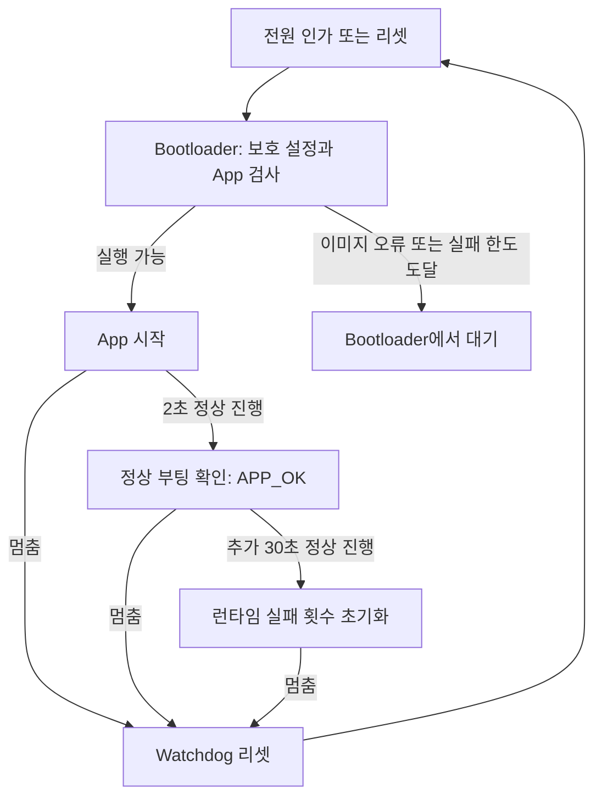
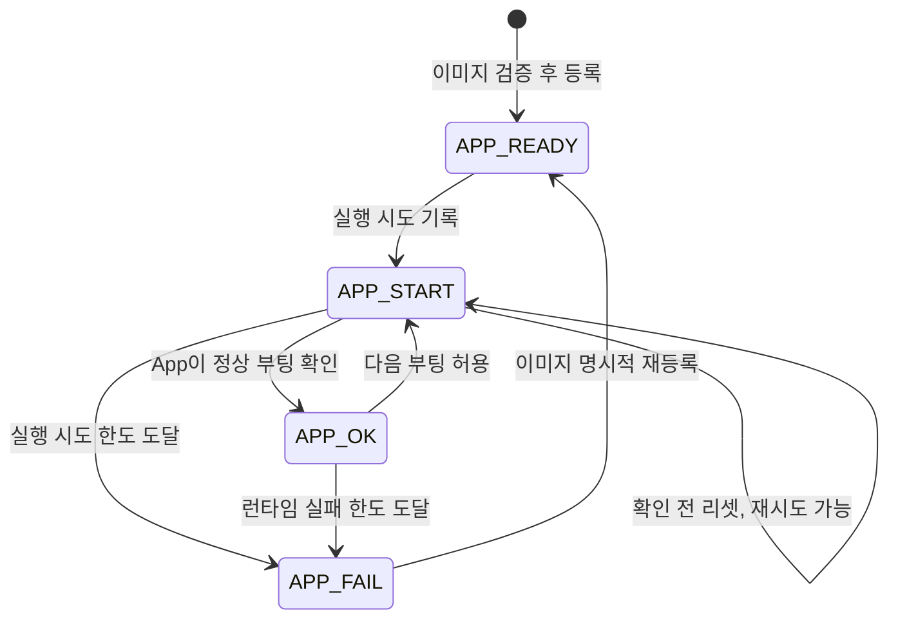
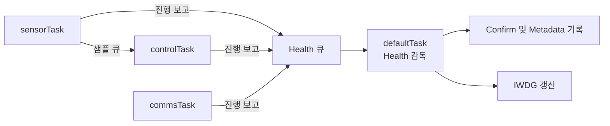

# STM32F446RE Bootloader 예제

Bootloader 및 Application 분리 예제.
이미지 검증, 부팅 상태 저장, watchdog 기반 장애 감지, Bootloader 쓰기 보호를 구현한다.

`bootFW`는 이미지 검증과 App 진입을 담당한다. `AppFW`는 FreeRTOS Task를 실행하고 부팅 결과를 기록한다.
두 프로젝트는 독립적으로 빌드하며, 부팅 상태는 Flash의 Metadata 영역에 저장한다.

## 부팅 절차



Recovery 진입 시 Bootloader의 주 루프에서 대기하며 IWDG를 갱신한다.
WRP를 새로 설정한 경우에도 대기 상태로 진입한다. 설정 반영에는 전원 재인가가 필요하다.

## 빌드 및 Flash 기록

### 1. 빌드와 초기 Metadata 준비

STM32CubeIDE에서 `bootFW`와 `AppFW`를 열고 Refresh 후 빌드한다.
`Shared` 폴더는 두 프로젝트와 같은 상위 폴더에 둔다.

App 링크 후 FW Header의 크기·버전·CRC를 기록해야 한다.
IDE의 post-build 설정에서 `tools/finalize_firmware.py`를 호출한다.
Python 보조 도구는 Git 추적 대상에서 제외되어 있다. 새 clone 환경에서는 별도 준비가 필요하다.

로컬 도구가 있는 환경의 빌드 및 초기 Metadata 생성 명령:

```powershell
python tools/build_firmware.py --fw-version 0x00010000
python tools/provision_metadata.py build/AppFW/AppFW.bin --fw-version 0x00010000
```

IDE 빌드도 Header 기록과 Metadata 생성이 필요하다.
IDE post-build의 기본 버전은 `0x00010000`이며 Metadata에 지정한 버전과 일치해야 한다.
Header가 미완성인 ELF/BIN은 이미지 검증에서 실패한다.

### 2. Flash 기록

최초 설치 시 전체 Flash를 삭제한 뒤 STM32CubeProgrammer 등으로 다음 파일을 기록한다.
기존 WRP가 적용된 보드는 Sector 0·1의 보호 해제가 필요하다. 관련 절차는 오류 진단 항목에 기재한다.

| 파일 | 기록 시작 주소 | 예약 영역 |
|---|---|---|
| `build/bootFW/bootFW.bin` | `0x08000000` | 32 KiB, Sector 0–1 |
| `build/AppFW/AppFW.bin` | `0x08010000` | 448 KiB, Sector 4–7 |
| `build/provision/metadata_a.bin` | `0x08008000` | 16 KiB, Sector 2 |
| `build/provision/metadata_b.bin` | `0x0800C000` | 16 KiB, Sector 3 |

Metadata는 Flash에 기록할 App BIN을 기준으로 생성한다.
App 재빌드 시 Metadata도 재생성해야 한다. 외부에서 Metadata를 재등록할 때는 Sector 2·3을 모두 삭제한 뒤 기록한다.
현재 Metadata 형식은 버전 2이며 이전 버전과 호환되지 않는다.

기존 Sector 6·7 Metadata 배치에서 변경한 경우 Bootloader와 App을 모두 다시 빌드·기록한다.
App 시작 주소는 `0x08010000`으로 변경되며 이전 Metadata의 자동 이전은 지원하지 않는다.
App 영역인 Sector 4–7과 새 Metadata 영역인 Sector 2·3을 삭제한 뒤 새 이미지를 기록한다.
Bootloader 갱신 시에는 기존 Sector 0·1 WRP도 해제해야 한다. Metadata 예약 공간은 총 256 KiB에서 32 KiB로 감소한다.

### 3. 정상 실행 확인

WRP를 새로 설정한 경우 전원을 완전히 차단한 뒤 재인가한다.
실행 상태는 다음 변수로 확인한다. LED 및 UART 상태 출력은 미구현이다.

| 확인할 값 | 정상 결과 |
|---|---|
| App의 `app_sensor_heartbeat`, `app_control_heartbeat`, `app_comms_heartbeat` | 각 Task의 정상 처리 시 증가 |
| App의 `app_health_failed_tasks` | 정상 시 0. Sensor=bit 0, Control=bit 1, Comms=bit 2 |
| App의 `app_confirm_result` | 약 2초 안정 동작 후 `BOOT_SUCCESS` |
| App의 `app_runtime_result` | Confirm 후 30초 안정 동작 시 `BOOT_SUCCESS` |
| 최신 Metadata의 `boot_state` / `boot_attempts` | `APP_OK` / `0` |

Bootloader의 `boot_metadata`는 App 진입 전 스냅샷이다.
Confirm 이후 상태는 `Boot_MetadataRead()` 또는 Flash의 최신 레코드로 확인한다.

## 상태 관리 및 장애 감지

### 부팅 상태



`APP_READY`는 이미지 등록 완료, `APP_START`는 실행 시도 중, `APP_OK`는 부팅 확인 완료, `APP_FAIL`은 실행 차단 상태다.
이미지 검증 실패도 실행 차단 조건에 해당한다. 유효한 Metadata가 없으면 새 상태를 생성하지 않고 Recovery로 진입한다.

부팅 실패와 런타임 실패는 별도 카운터로 관리한다.

| 구분 | 판단 기준 | 차단 및 초기화 |
|---|---|---|
| 부팅 실패 | `APP_START`에서 Confirm 없이 리셋 | 최대 3회 실행 시도. 세 번째도 미확정이면 다음 부팅 차단. Confirm 성공 시 횟수 초기화 |
| 런타임 실패 | `APP_OK` 이후 IWDG/WWDG 리셋 | 3회 누적 시 차단. Confirm만으로 지우지 않고 이후 30초 정상 동작 시 초기화 |

Confirm 이전의 전원 중단 및 수동 리셋도 부팅 시도를 소비한다.
Confirm 이후의 전원·수동 리셋은 런타임 실패 횟수를 증가시키거나 초기화하지 않는다.
POR/BOR와 watchdog flag가 동시에 설정된 경우 전원 리셋으로 우선 분류한다.

### 작업 진행 감시 및 IWDG

CMSIS-RTOS v2 API를 사용한다. `main()`에서 커널과 큐·Task를 생성한 뒤 `osKernelStart()`를 호출한다.
기존 `main()`의 무한 루프에서는 Health를 처리하지 않는다. HAL 시간 기준은 TIM6, FreeRTOS tick은 SysTick을 사용한다.

| Task | 실행 조건 | 우선순위 / 스택 | 처리 |
|---|---|---|---|
| `sensorTask` | 100 ms 주기 | Normal / 1,024 bytes | 모의 센서 값 생성, 샘플 큐에 전달 |
| `controlTask` | 샘플 수신 시, 수신 대기 최대 200 ms | Normal / 1,024 bytes | 샘플 값 연산 후 제어 값 갱신 |
| `commsTask` | 250 ms 주기 | Normal / 1,024 bytes | 제어 값으로 모의 telemetry checksum 생성 |
| `defaultTask` | 20 ms 주기 | AboveNormal / 2,048 bytes | Health 감독, Confirm, 런타임 확인, IWDG 갱신 |



ADC·UART는 사용하지 않는다. 예제 Task는 처리 완료 후 큐로 작업 비트와 완료 시각을 보고한다.
감독 Task만 `AppHealth_Progress()`와 `AppHealth_Poll()`을 호출하여 공유 상태의 동시 수정을 방지한다.
Health 자체는 RTOS에 의존하지 않으며, 큐와 Task 연결은 `app_tasks.c`에서 처리한다.

| 설정 | 현재 값 | 의미 |
|---|---|---|
| 작업 진행 기한 | 1초 | 필수 작업의 보고가 1초 초과 지연되면 Feed 중단 |
| 부팅 확인 | 2초 | 모든 필수 작업이 보고된 뒤 안정적으로 진행하면 Confirm |
| 부팅 확인 제한 | 8초 | Health 감시 시작 후 Confirm 미처리 시 Feed 중단 |
| 런타임 안정 구간 | Confirm 후 30초 | 런타임 실패 횟수 초기화 |
| IWDG timeout | nominal 약 32.8초 | 마지막 Feed 이후 카운터가 소진되면 MCU 리셋 |

작업 진행 기한 초과 시 IWDG 갱신을 중단한다. MCU 리셋은 마지막 갱신 이후 IWDG timeout이 경과하면 발생한다.
장애가 latch되면 이후 진행 보고가 들어와도 갱신을 재개하지 않는다.
Metadata 기록 전 Health 큐를 비운다. 기록 중에는 스케줄러만 잠그고 인터럽트는 유지한다.
성공한 동기 기록 시간은 Health 기한에서 제외한 뒤 스케줄러를 복구한다. 기록 중에도 IWDG는 동작한다.
Flash 기록은 감독 Task에서만 수행하며 작업 Task나 ISR에서 호출하지 않는다.
스택 초과 및 힙 할당 실패 hook은 `Error_Handler()`로 진입해 watchdog 리셋을 유도한다.

### Metadata 저장

Metadata는 부팅 상태·이미지 정보·실패 횟수를 포함하는 64바이트 레코드다.
새 레코드를 빈 슬롯에 추가하고 마지막에 `commit`을 기록한다. 읽기 시 CRC와 commit이 유효한 최신 레코드를 선택한다.

현재 섹터에 빈 슬롯이 없으면 반대편 섹터를 삭제하고 기록한다. 삭제·기록 중 전원 차단에 대비해 이전 최신 레코드가 있는 섹터는 유지한다.
최초 등록 중 유효한 레코드가 하나도 남지 않은 경우 외부 재등록이 필요하다.

### 이미지 검증

FW Header는 App의 `0x08010200`에 배치되는 32바이트 구조체다.
Magic·크기·버전·CRC·적재 주소를 포함한다. 부팅 시 Header와 Metadata의 이미지 정보가 일치하는지 검사한다.

| 상황 | 전체 이미지 CRC |
|---|---|
| 설치 직후, 최초 부팅, 미확인 부팅 재시도 | 검사 |
| 전원·저전압·watchdog·원인 불명 등의 리셋 | 검사 |
| 런타임 실패 기록이 남아 있음, 주기적 재검증 시점, 강제 요청 | 검사 |
| Confirm된 App의 software/pin 리셋이며 위 조건이 없음 | 생략 |

Header와 벡터 검사는 매 부팅 수행한다. 전체 CRC를 생략한 재부팅에서는 본문 손상이 다음 전체 검사까지 검출되지 않을 수 있다.
서명 기반 이미지 인증은 미구현이다.

## 소스 구성

| 순서 | 파일 | 구현 내용 |
|---|---|---|
| 1 | [bootFW/main.c](bootFW/Core/Src/main.c) | 부팅 판단 → App 점프 또는 대기 |
| 2 | [AppFW/main.c](AppFW/Core/Src/main.c) / [app_tasks.c](AppFW/Core/Src/app_tasks.c) | 커널 시작, 작업 Task, Health 감독 |
| 3 | [boot_state.c](Shared/boot_state.c) | Metadata 저장, 실패 판정, CRC 정책 |
| 4 | [app_health.c](Shared/app_health.c) / [boot_watchdog_stm32.c](Shared/boot_watchdog_stm32.c) | 작업 기한 검사와 IWDG 제어 |
| 5 | [boot_protection.c](bootFW/Core/Src/boot_protection.c) | Bootloader 쓰기 보호 |

메모리 주소와 실패 한도는 [boot_state.h](Shared/boot_state.h), Health 시간 설정은 [app_health.h](Shared/app_health.h)에 정의한다.

## 오류 진단

| 증상 | 확인 항목 |
|---|---|
| 첫 실행이 Bootloader에서 멈춤 | `boot_protection_result`가 전원 재인가 요청인지 확인 |
| 계속 Bootloader에서 대기 | `boot_result`와 `boot_recovery_mode` 확인. Metadata·Header·CRC·실패 횟수 검사 |
| App 변경 후 실행 불가 | 같은 App BIN으로 Metadata를 다시 생성했는지 확인 |
| 빌드 후 Python 파일 오류 | Git에서 제외된 로컬 도구가 있는지, post-build 경로가 맞는지 확인 |
| Bootloader 재기록/전체 삭제 실패 | STM32CubeProgrammer에서 Sector 0·1의 WRP만 해제한 뒤 기록. 실행 후 다시 보호되면 전원 재인가 |
| 디버깅 중 watchdog 리셋이 안 보임 | IWDG freeze 설정 확인. CPU를 계속 실행한 상태에서 시험 |

WRP는 Sector 0·1에만 적용하며 RDP·BOR·watchdog 옵션은 변경하지 않는다.
PCROP 모드인 경우 보호 모드를 변경하지 않고 Recovery로 진입한다.

## 검증

호스트 테스트는 상태 전이와 Flash 오류를 모사한다. 실제 보드의 전원 차단·IWDG timeout·쓰기 보호 검증은 별도 수행해야 한다.

```powershell
New-Item -ItemType Directory -Path build/tests -Force
gcc -std=c11 -O2 -Wall -Wextra -Werror Shared/boot_state.c tests/test_boot_state.c -o build/tests/test_boot_state.exe
./build/tests/test_boot_state.exe
gcc -std=c11 -O2 -Wall -Wextra -Werror Shared/app_health.c tests/test_app_health.c -o build/tests/test_app_health.exe
./build/tests/test_app_health.exe
gcc -std=c11 -O2 -Wall -Wextra -Werror -Itests/protection_mock bootFW/Core/Src/boot_protection.c tests/test_boot_protection.c -o build/tests/test_boot_protection.exe
./build/tests/test_boot_protection.exe
```

`tests/protection_mock/stm32f4xx_hal.h`는 호스트 테스트용이며 펌웨어 include 경로에서 제외한다.
보드 시험 시 디버거에서 `app_fault_injection`을 변경한다. 리셋 후 값은 0이다.

| 값 | 주입 동작 |
|---|---|
| 1 | Sensor Task 무한 루프. 감독 Task는 높은 우선순위로 계속 실행 |
| 2 | 센서 샘플은 계속 생성하고 센서 진행 보고만 중단 |
| 3 | Control Task 처리 중단 |
| 4 | Comms Task 처리와 진행 보고 중단 |
| 5 | 감독 Task 대기. 작업 Task는 계속 실행하지만 IWDG 갱신 중단 |

`app_health_failed_tasks`로 누락된 작업 비트를 확인한다. 큐 포화로 보고가 유실되면 `app_report_drops`가 증가한다.
이 진단 변수는 RAM에 있으며 리셋 후 초기화된다.
Control 정지 시 샘플 큐가 가득 차 Sensor 진행도 중단될 수 있다.
Confirm 이전과 이후에 각각 주입하여 부팅 실패와 런타임 실패 판정을 검증한다.

### 구현 조건

- 전체 CRC 강제 부팅 준비: `Boot_PrepareEx(flags, 1, &metadata)`.
- 전체 CRC 수동 진단: `Boot_VerifyFirmware()`. 검사 결과만 반환하며 상태를 변경하지 않는다.
- 주기적 CRC 조건: 부팅 준비 전 `total_boots`가 16의 배수일 때.
- 이미지 CRC는 두 CRC 필드를 0으로 간주하고 계산한다. Header CRC는 자기 필드만 0으로 간주한다.
- Metadata CRC 범위는 앞 56바이트이며 마지막 4바이트는 commit이다.
- Flash 상태 변경 API는 HAL tick과 인터럽트가 활성화된 실행 흐름에서 호출한다. App은 TIM6 기반 HAL tick을 사용한다. ISR·동시 호출은 지원하지 않는다.
- IWDG는 software-start 설정과 `/256`, reload `4095`를 사용한다. 실제 timeout은 LSI 오차에 따라 달라진다.

하드웨어 동작 기준: [ST STM32F446 Reference Manual, RM0390](https://www.st.com/resource/en/reference_manual/dm00135183.pdf).
